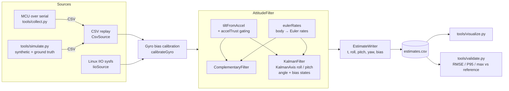

# GyroFuse

GyroFuse tracks IMU attitude with a Kalman filter. It is a C++17 sensor-fusion library and
CLI. It combines 3-axis accelerometer and gyroscope data into roll, pitch and yaw estimates.
Two estimators are included: a **complementary filter** and a **Kalman filter** that also
estimates gyro bias. Python tools generate synthetic data with ground truth, capture data
from real sensors (serial microcontroller or Linux IIO), plot the results, and check the
filters against reference angles.

## What it does

- **Accelerometer tilt.** Roll and pitch come from the gravity vector:
  `roll = atan2(ay, az)` and `pitch = atan2(-ax, sqrt(ay² + az²))`.
- **Gyro integration.** Body rates `(p, q, r)` are converted to ZYX Euler rates and integrated.
- **Complementary filter.** It blends the two sources with
  `angle = α·(angle + rate·dt) + (1-α)·accel_angle`, where `α = τ/(τ+dt)`. The gyro handles fast
  motion and the accelerometer corrects slow drift.
- **Kalman filter.** Roll and pitch each get a 2-state `[angle, gyro_bias]` linear KF:
  - `F = [[1, -dt], [0, 1]]`, `Q = diag(q_angle, q_bias)·dt`, and `H = [1, 0]`.
  - The covariance update uses the Joseph form, so P stays symmetric positive-definite.
  - Innovations are wrapped, so the filter works across ±180°.
  - The filter learns the gyro bias online. The estimate converges even when the gyro has a constant offset.
- **Accel magnitude gating.** During linear acceleration, `|a|` moves away from 1 g. The
  measurement variance then grows by `1/trust²`. When trust drops below a threshold, the
  correction is skipped. A sideways shove is not read as tilt.
- **Static gyro calibration.** The `--calibrate S` option averages the gyro over the first
  S seconds while the device is still. It warns if it detects motion during that window.
- **Sources.** The filters can replay CSV files or poll a Linux IIO IMU through sysfs.
  Supported drivers include MPU6050/MPU9250 (`inv_mpu6050`), BMI160 and LSM6DS\*.

Yaw comes from gyro integration only. There is no magnetometer, so heading drifts slowly.
This is a physical limit of a 6-DoF IMU.

## Architecture



```
GyroFuse/
├── CMakeLists.txt
├── include/gyrofuse/      # public headers (math, filters, sources, CSV I/O)
├── src/                   # library implementation
├── apps/gyrofuse_cli.cpp  # `gyrofuse` command line tool
├── tests/                 # dependency-free C++ unit tests (CTest)
└── tools/                 # Python: simulate, collect, visualize, validate (+ pytest)
```

## Data format

Input CSV (header required, columns matched by name, `#` comments allowed):

| column | unit | notes |
|---|---|---|
| `t` | s | monotonic timestamp |
| `ax, ay, az` | m/s² | specific force; a still, level sensor reads `az ≈ +9.81` |
| `gx, gy, gz` | rad/s | body angular rate |
| `roll_ref, pitch_ref, yaw_ref` | rad | optional ground truth |

Output CSV: `t,roll,pitch,yaw,bias_x,bias_y,bias_z[,roll_ref,pitch_ref,yaw_ref]`. Angles are
in radians, or in degrees if you pass `--degrees`.

## How to run

Requirements: a C++17 compiler (GCC ≥ 8 / Clang ≥ 7), CMake ≥ 3.16, and Python ≥ 3.9 for
the tools.

```bash
# Build library, CLI and tests
cmake -B build -DCMAKE_BUILD_TYPE=Release
cmake --build build -j

# Python tooling
python3 -m venv .venv && source .venv/bin/activate
pip install -r tools/requirements.txt

# 1. Generate a 60 s synthetic dataset with gyro bias, noise and linear-accel bursts
python tools/simulate.py --out data/sim.csv

# 2. Run a filter
./build/gyrofuse --input data/sim.csv --filter kalman --calibrate 2 --output out/kalman.csv
./build/gyrofuse --input data/sim.csv --filter complementary --tau 0.5 --output out/comp.csv

# 3. Plot
python tools/visualize.py out/kalman.csv out/comp.csv --raw data/sim.csv --save out/plot.png
```

### Real hardware

- **Linux IIO IMU.** This covers boards like a Raspberry Pi with an MPU6050 on I²C and the
  `inv_mpu6050` overlay. Reading sysfs may require root or a udev rule.
  ```bash
  ./build/gyrofuse --iio auto --rate 200 --duration 30 --calibrate 2 --degrees
  python tools/collect.py iio --device auto --rate 200 --seconds 30 --out data/run.csv
  ```
- **Microcontroller over serial.** Firmware should print `ax,ay,az,gx,gy,gz` lines, by
  default in g and deg/s:
  ```bash
  python tools/collect.py serial --port /dev/ttyACM0 --baud 115200 --seconds 30 --out data/run.csv
  ./build/gyrofuse --input data/run.csv --calibrate 2 --degrees
  ```
  If you have an external reference angle, such as an encoder, a turntable or motion capture,
  stream it as three extra degree fields and pass `--with-ref`. You can then validate the
  real capture.

### Tuning

| flag | effect |
|---|---|
| `--tau` | Complementary crossover. Larger values trust the gyro longer (smoother, but slower drift correction). |
| `--q-angle` | Kalman angle process noise. Raise it for agile motion. |
| `--q-bias` | How fast the Kalman filter lets the bias wander. Raise it for faster bias tracking. |
| `--r-measure` | Accel angle variance. Raise it if the accelerometer is noisy or vibrating. |
| `--accel-tol` | Gating tolerance on `|a|` as a fraction of g. |

## How to test

```bash
# C++ unit tests (matrix, tilt, complementary, Kalman, CSV, calibration)
cmake -B build && cmake --build build -j
ctest --test-dir build --output-on-failure
./build/gyrofuse_tests kalman          # run only tests whose name contains "kalman"

# Python unit tests (metrics, simulator kinematics, CSV round-trip)
pytest tools/tests

# End-to-end validation against ground truth. It exits non-zero if roll/pitch RMSE > 3 deg.
python tools/simulate.py --out data/sim.csv
python tools/validate.py data/sim.csv --binary build/gyrofuse --calibrate 2 \
    --json out/report.json --plot out/validation.png
```

`validate.py` prints RMSE, P95, max and mean error for each axis. It reports three methods:
the accelerometer-only baseline, the complementary filter, and the Kalman filter. You can
see how much fusion helps during the simulated linear-acceleration bursts.

## Hardware / credentials

No credentials are needed. Hardware is optional. Everything can run offline on simulated
data. For live capture you need one of two setups. The first is a Linux machine with an IIO
IMU driver. The second is any microcontroller that streams IMU readings over a serial port.
